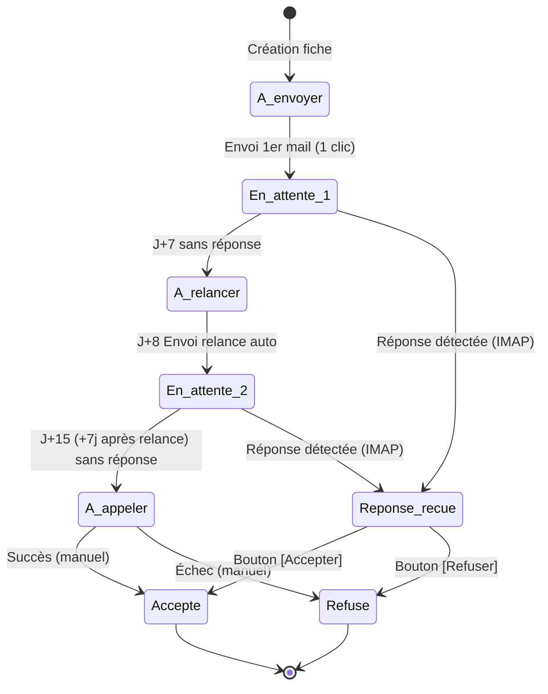

# Cahier des Charges Fonctionnel et Technique

**Projet :** AlterTrack — Application Mobile & Serveur d'Automatisation de Candidatures d'Alternance  
**Date :** Octobre 2026  
**Auteur :** Rafael Martinez  

---

## 1. Présentation du projet

### 1.1 Contexte et problématique
La recherche d'un contrat d'alternance nécessite de contacter un grand volume d'entreprises, d'adapter chaque prise de contact, de suivre rigoureusement l'état de chaque candidature et de relancer les recruteurs au bon moment. Réalisées manuellement, ces tâches sont chronophages et sujettes aux oublis (relances tardives, perte de fil des échanges).
### 1.2 Objectifs principaux et secondaires
* **Objectif principal :** Centraliser le suivi des candidatures d'alternance dans une application mobile Android et automatiser l'envoi des candidatures initiales, les relances programmées et la détection des réponses via Gmail et l'IA Google Gemini.
* **Objectifs secondaires :**
  * **Coût de fonctionnement nul (0 €) :** En s'appuyant sur l'auto-hébergement (PC secondaire) et des services gratuits.
  * **Prise de décision rapide :** Grâce à des notifications Push en temps réel dès qu'un recruteur répond.

---

## 2. Public cible et profils utilisateurs

* **Profil unique (Mono-utilisateur) :** L'application est conçue pour l'usage exclusif de son créateur (étudiant en recherche d'alternance).
* **Conséquence technique :** Aucun système complexe de gestion multi-comptes (inscription publique, rôles multiples) n'est requis. Une protection par clé d'API (Token statique dans les en-têtes HTTP) suffit à sécuriser la communication entre l'application mobile et le serveur personnel.

---

## 3. Périmètre et Fonctionnalités détaillées

### 3.1 Gestion des fiches Entreprises (CRUD & Import Tableur)
L'utilisateur peut créer, consulter, modifier et supprimer des fiches entreprises.

#### Création unitaire manuelle
Chaque fiche contient :
* **Nom de l'entreprise** (Obligatoire)
* **Adresse e-mail de contact** (Obligatoire pour l'envoi automatisé)
* **Numéro de téléphone** (Optionnel / requis pour l'étape d'appel)
* **Statut initial** (Sélectionnable parmi les 7 statuts du cycle de vie, par défaut : `À envoyer`)
* **Note / Description** (Texte libre strictement personnel pour noter des informations sur l'entreprise ; non transmis à l'IA).

#### Importation en masse par tableur (Excel & CSV)
L'application mobile et le backend intègrent un module d'importation de tableurs :
* **Formats pris en charge :** Microsoft Excel (`.xlsx`, `.xls`) et fichiers délimités (`.csv`).
* **Détection intelligente des colonnes :** Analyse souple des en-têtes (ex: Nom / Entreprise / Société, Email / Courriel, Téléphone / Mobile, Notes / Remarques / Poste, Statut).
* **Validation & Dédoublonnage :** Vérification stricte du format email, élimination des doublons internes au fichier et des emails déjà enregistrés dans la base AlterTrack.
* **Résultat d'import détaillé :** Compte-rendu immédiat (nombre de fiches créées, fiches ignorées, motifs d'erreur par ligne).

### 3.2 Gestion du Profil d'envoi (Modèle & CV)
Depuis un écran « Paramètres » dans l'application mobile :
* **Modèle de mail unique :** L'utilisateur saisit et modifie un texte de base (*template*) qui servira de référence à l'IA.
* **Gestion du CV :** L'utilisateur sélectionne un fichier PDF depuis son téléphone. Ce fichier reste stocké dans l'application et est automatiquement synchronisé (uploadé) sur le serveur NestJS afin d'être joint aux envois manuels et aux relances automatiques.

### 3.3 Génération par Intelligence Artificielle (Google Gemini)
Lorsqu'un e-mail doit être envoyé (1er contact ou relance à J+8), le backend NestJS interroge l'API Google Gemini :
* **Données envoyées à l'IA :** Uniquement le Nom de l'entreprise, le Modèle de mail pré-fait, et la Nature de l'envoi (Premier contact OU Relance après 7 jours sans réponse).
* **Données attendues de l'IA :** Un objet JSON structuré :
  ```json
  {
    "subject": "Objet généré",
    "body": "Corps du mail généré"
  }
  ```

### 3.4 Envoi groupé en 1 clic (Premier contact)
* Sur l'écran principal, un bouton d'action permet de lancer l'envoi pour toutes les entreprises ayant le statut `À envoyer`.
* Pour chaque entreprise concernée, le serveur :
  1. Génère l'objet et le corps via Gemini.
  2. Attache le CV en PDF.
  3. Expédie l'e-mail via le compte Gmail de l'utilisateur.
  4. Passe le statut de l'entreprise à `En attente de réponse`.

### 3.5 Automatisation des relances et du suivi (Machine à états)
Le serveur NestJS exécute une tâche planifiée (*Cron Job*) quotidienne qui vérifie l'ancienneté des candidatures :
1. **Transition à J+7 (`En attente de réponse` $\rightarrow$ `À relancer`) :**  
   Si un premier mail a été envoyé il y a 7 jours et qu'aucune réponse n'a été reçue, l'entreprise passe automatiquement au statut `À relancer`.
2. **Envoi automatique de la relance à J+8 (Le lendemain) :**  
   Pour toute entreprise au statut `À relancer` depuis 24h (soit 8 jours après le 1er mail), le serveur génère un mail de relance via Gemini (à partir du même modèle de base avec la consigne de rédiger une relance courtoise), joint le CV, envoie le mail via Gmail, et enregistre la date de relance. Le statut repasse à `En attente de réponse` avec l'indicateur de relance renseigné.
3. **Transition à J+15 (`En attente de réponse` $\rightarrow$ `À appeler`) :**  
   Si 7 jours supplémentaires s'écoulent après l'envoi du mail de relance sans aucune réponse détectée, la fiche passe automatiquement au statut `À appeler` (et déclenche une notification Push pour prévenir l'utilisateur).

### 3.6 Détection automatique des réponses et Notifications Push
* Un Cron Job sur le serveur vérifie la boîte de réception Gmail toutes les 10 minutes (via le protocole IMAP).
* Si un nouveau message entrant provient de l'adresse e-mail (ou du nom de domaine spécifique) d'une entreprise enregistrée :
  1. Le statut de l'entreprise passe immédiatement à `Réponse reçue` (ce qui désactive toute relance automatique future).
  2. Le serveur envoie une Notification Push gratuite (via Expo Push Notifications) sur le téléphone Android :  
     > *« Nouvelle réponse reçue de [Nom de l'entreprise] ! »*

### 3.7 Actions rapides sur le statut "Réponse reçue"
Lorsque l'utilisateur ouvre la fiche d'une entreprise ayant le statut `Réponse reçue`, l'interface met en évidence deux boutons d'action directe :
* **[ Accepter ]** $\rightarrow$ Passe la fiche au statut final `Accepté`.
* **[ Refuser ]** $\rightarrow$ Passe la fiche au statut final `Refusé`.

---

## 4. Règles de gestion (Synthèse des 7 Statuts)

### Tableau synthétique des statuts

| # | Statut | Déclencheur / Origine | Comportement système | Statut suivant |
|---|---|---|---|---|
| **1** | **À envoyer** | Création manuelle de la fiche | En attente du clic sur le bouton « Envoyer les mails » | `En attente de réponse` |
| **2** | **En attente de réponse** | Automatique après envoi du mail (1er contact ou relance) | Compteur de 7 jours actif + surveillance IMAP des réponses entrantes | `À relancer` (si 1er mail), `À appeler` (si relance faite), ou `Réponse reçue` |
| **3** | **À relancer** | Automatique à J+7 sans réponse après le 1er mail | Tampon de 24h : envoi automatique du mail de relance le lendemain (J+8) | `En attente de réponse` (avec indicateur de relance effectuée) |
| **4** | **À appeler** | Automatique à J+7 sans réponse après la relance (J+15 total) | Stoppe tout envoi de mail. Affiche un bouton d'appel téléphonique direct | `Accepté` ou `Refusé` (action manuelle) |
| **5** | **Réponse reçue** | Automatique dès détection d'un mail entrant de l'entreprise | Envoi d'une notification Push + Arrêt immédiat des relances + Affichage des boutons Accepter/Refuser | `Accepté` ou `Refusé` (action manuelle) |
| **6** | **Refusé** | Action manuelle de l'utilisateur | Aucune action automatisée (Archivage / Fin du cycle) | *Statut terminal* |
| **7** | **Accepté** | Action manuelle de l'utilisateur | Aucune action automatisée (Succès / Fin du cycle) | *Statut terminal* |

### Machine à états (Workflow)



> [!IMPORTANT]
> **Règle anti-spam critique :** Une entreprise ne peut recevoir au maximum que **2 e-mails automatiques** (1 premier contact + 1 relance à J+8). Le champ `followUpSentAt` en base de données empêche toute boucle infinie.

---

## 5. Expérience Utilisateur (UX) et Design (UI)

### 5.1 Identité visuelle & Charte Graphique Officielle

L'identité visuelle d'AlterTrack repose sur un thème sombre haute technologie, dynamique et orienté performance :

#### A. Le Logotype
* **Monogramme :** Lettre « A » stylisée avec des nœuds de réseau interconnectés et traversée par une **flèche ascendante ↗** (symbolisant la progression des candidatures et le succès).
* **Typographie du mot-symbole :** 
  * **Alter :** Blanc pur (`#FFFFFF`) avec contour subtil.
  * **Track :** Cyan Turquoise vibrant (`#00D2C4`).

#### B. La Palette de Couleurs Officielle

| Rôle dans la charte | Code Hex | Nuance | Usage UI |
|---|---|---|---|
| **Fond principal (Primary Dark)** | `#0B0F19` | Noir bleuté profond | Toile de fond globale de l'application |
| **Surface cartes & formulaires** | `#131B2E` | Navy profond | Cartes d'entreprises, modales, champs |
| **Primary Blue** | `#0066FF` | Bleu électrique vibrant | Boutons d'action principaux, statut `À envoyer` |
| **Primary Cyan / Turquoise** | `#00D2C4` | Cyan lumineux | Accentuation de marque (`Track`), statut `Réponse reçue` |
| **Accent Green** | `#00F099` | Vert menthe fluo | Actions de succès, statut `Accepté` |
| **Blanc pur** | `#FFFFFF` | Blanc haute luminosité | Titres, textes principaux, boutons secondaires |
| **Soft White** | `#F0F4F8` | Blanc doux | Surfaces secondaires claires |

#### C. Typographie
* **Titres & En-têtes :** **Urbanist** (Bold & Medium) — géométrique, moderne et impactant.
* **Textes courants & Éléments UI :** **Inter** (Regular, Medium, Light) — lisibilité maximale sur écrans mobiles.

#### D. Éléments Graphiques & Boutons UI
* **Boutons principaux :** Forme pilule arrondie (`borderRadius: 24`), couleur bleu roi `#0066FF` ou dégradé cyan/menthe (`#00D2C4` $\rightarrow$ `#00F099`).
* **Boutons secondaires :** Bouton pilule blanc (`#FFFFFF`) avec texte sombre (`#0B0F19`).
* **Courbes & Graphiques :** Lignes de tendance dynamiques cyan et vertes sur fond sombre.

#### E. Palette des badges de statut

| Statut | Code Couleur | Aperçu indicatif | Rôle visuel |
|---|---|---|---|
| **À envoyer** | `#0066FF` | Bleu roi officiel | Prêt à l'expédition (neutre/actif) |
| **En attente de réponse** | `#F59E0B` | Jaune ambré | Surveillance active (J+0 à J+7) |
| **À relancer** | `#F97316` | Orange vif | Attention requise (J+7) |
| **Réponse reçue** | `#00D2C4` | Cyan Turquoise officiel | **Priorité visuelle absolue** |
| **À appeler** | `#00D2C4` | Cyan lumineux | Action téléphonique directe (J+15) |
| **Accepté** | `#00F099` | Vert menthe officiel | Succès / Embauche validée |
| **Refusé** | `#EF4444` | Rouge corail | Candidature non retenue |

### 5.2 Structure des écrans (React Native)

1. **Écran d'accueil (Dashboard & Liste) :**
   * **En haut :** Barre de recherche (par nom d'entreprise) + Barre d'onglets horizontale avec défilement pour filtrer par statut.
   * **Au centre :** Liste des cartes entreprises (Nom, Badge de statut, Date du dernier envoi / changement).
   * **En bas :** Deux boutons flottants d'action (*FAB*) :
     * Un bouton `+` pour ajouter une nouvelle entreprise.
     * Un bouton `Envoyer (X)` (visible lorsqu'il existe des entreprises au statut `À envoyer`).
2. **Écran Fiche Entreprise (Détail / Édition) :**
   * Informations affichées : Nom, Email, Téléphone (cliquable pour lancer l'application téléphone Android), Statut modifiable manuellement, Note personnelle.
   * **Zone contextuelle dynamique :** Si le statut est `Réponse reçue`, affichage d'une bannière prépondérante en haut de l'écran avec deux boutons larges `[ Accepter ]` et `[ Refuser ]`.
3. **Écran Paramètres (Profil & Modèle) :**
   * Zone de texte (*Textarea*) pour éditer le modèle de mail de référence.
   * Bouton d'importation du CV (`expo-document-picker`) avec affichage du nom du fichier PDF actif.
   * Champ de configuration de l'URL du serveur (liaison de l'application mobile au PC serveur).

---

## 6. Architecture Technique & Modèle de Données

### 6.1 Stack Technique

* **Application Mobile :** React Native avec **Expo** (TypeScript), `expo-notifications` (Push), `expo-document-picker` & `expo-file-system` (gestion locale et synchronisation du CV).
* **Serveur Backend :** **NestJS** (TypeScript) avec `@nestjs/schedule` pour l'ordonnancement des tâches (*Cron Jobs*).
* **Base de données :** **PostgreSQL** piloté via l'ORM **Prisma**.
* **Service IA :** SDK officiel `@google/genai` (Modèle recommandé : `gemini-2.5-flash`).
* **Service E-mail (Gmail) :**
  * **Envoi :** **Nodemailer** via SMTP (`smtp.gmail.com`, port 465 SSL) avec mot de passe d'application Google.
  * **Réception :** Bibliothèque **imapflow** (`imap.gmail.com`, port 993 SSL) pour inspecter les nouveaux e-mails entrants toutes les 10 minutes.

### 6.2 Modèle de données simplifié

```prisma
// Exemple de schéma Prisma indicatif

model Company {
  id              String    @id @default(uuid())
  name            String
  email           String
  phone           String?
  notes           String?
  status          Status    @default(TO_SEND)
  firstMailSentAt DateTime?
  followUpReadyAt DateTime?
  followUpSentAt  DateTime?
  lastMailId      String?
  createdAt       DateTime  @default(now())
  updatedAt       DateTime  @updatedAt
}

model AppConfig {
  id               String   @id @default(uuid())
  template         String
  cvFilePath       String?
  cvOriginalName   String?
  expoPushToken    String?
  updatedAt        DateTime @updatedAt
}

enum Status {
  TO_SEND            // À envoyer
  WAITING_FOR_REPLY  // En attente de réponse
  TO_FOLLOW_UP       // À relancer
  TO_CALL            // À appeler
  REPLY_RECEIVED     // Réponse reçue
  REFUSED            // Refusé
  ACCEPTED           // Accepté
}
```

---

## 7. Guide d'architecture : Transformer le second PC en Serveur

1. **Préparation du PC Serveur :**
   * Dans les paramètres d'alimentation du système d'exploitation, désactiver la mise en veille automatique (maintien de fonctionnement 24/7).
2. **Conteneurisation avec Docker :**
   * Installer Docker et Docker Compose.
   * Configurer un fichier `docker-compose.yml` orchestrant PostgreSQL et l'API NestJS (`restart: always`).
3. **Accès à distance gratuit et sécurisé (VPN Mesh) :**
   * Installer **Tailscale** sur le PC serveur et sur le smartphone Android pour créer un réseau privé virtuel chiffré.
   * Permet de joindre le serveur via son adresse IP fixe privée Tailscale (ex: `100.x.y.z`), sans ouvrir de ports sur la box internet ni configurer de nom de domaine public.

---

## 8. Risques identifiés et parades techniques

| Risque | Impact potentiel | Parade technique |
|---|---|---|
| **Hallucination de l'IA Gemini** | Contenu inadapté ou déformation des faits | Température basse (`0.3`), prompt système strict contraignant Gemini à se baser fidèlement sur le modèle fourni. |
| **Faux positifs IMAP (ex. *no-reply*)** | Arrêt prématuré des relances | Le statut `Réponse reçue` stoppe les envois automatiques par précaution ; l'utilisateur conserve la possibilité de repasser manuellement au statut `En attente de réponse` en un clic. |
| **Blocage de sécurité Gmail** | Échec des connexions SMTP/IMAP | Activation de la validation en 2 étapes et génération d'un « Mot de passe d'application » dédié (16 caractères). |
| **PC Serveur éteint au moment d'un Cron** | Retard dans les relances programmées | Les requêtes de relance utilisent une condition temporelle `<=` (inférieur ou égal) pour traiter automatiquement tout retard dès le redémarrage. |

---

## 9. Planning de réalisation recommandé

```mermaid
gantt
    title Planning de réalisation AlterTrack
    dateFormat  X
    axisFormat  Étape %s
    section Backend & BD
    Étape 1 : Socle Backend & Base de données (NestJS, PostgreSQL, Prisma) : active, 0, 1
    section IA & Mailing
    Étape 2 : Intégration Gemini & Gmail (Génération, SMTP/IMAP)          : 1, 2
    section Automatisation
    Étape 3 : Automatisation & Machine à états (Cron Jobs J+7, J+8, J+15)  : 2, 3
    section Mobile
    Étape 4 : Application Mobile React Native (Expo, UI, upload CV)       : 3, 4
    section Déploiement
    Étape 5 : Notifications Push & Déploiement PC (Docker, Tailscale)     : 4, 5
```

* **Étape 1 — Socle Backend & Base de données :** Initialisation du projet NestJS, configuration de PostgreSQL et modélisation Prisma.
* **Étape 2 — Intégration Gemini & Gmail :** Implémentation du service Gemini (génération de mails) et des services Nodemailer / ImapFlow.
* **Étape 3 — Automatisation & Machine à états :** Mise en place des Cron Jobs (`@nestjs/schedule`) pour les règles J+7, J+8 et J+15.
* **Étape 4 — Application Mobile React Native :** Développement des écrans sous Expo, formulaire de gestion des entreprises, gestion du modèle et upload du CV.
* **Étape 5 — Notifications Push & Déploiement :** Configuration d'Expo Push Notifications, conteneurisation Docker et sécurisation du réseau via Tailscale.
